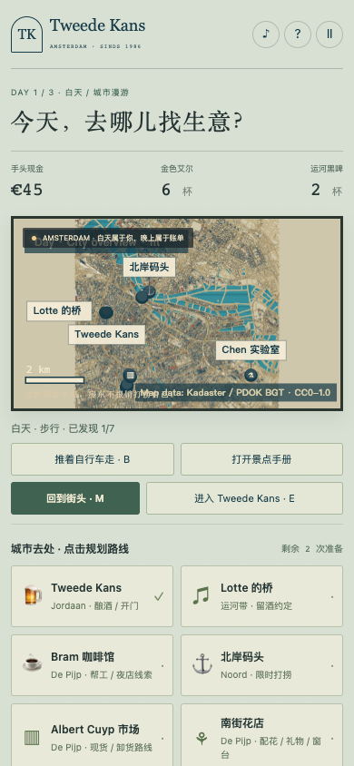
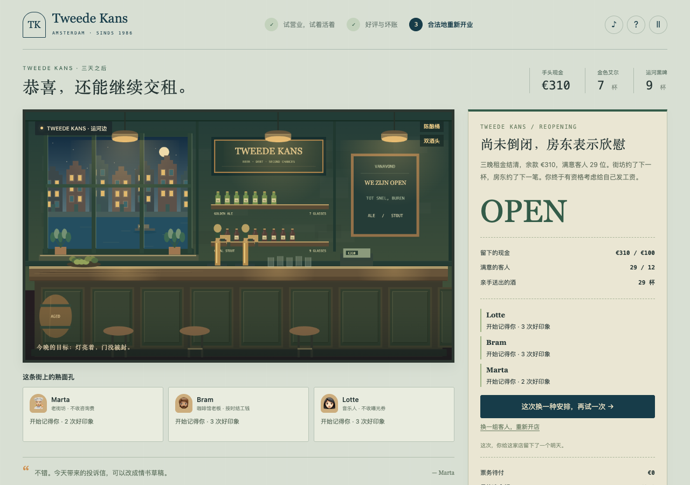

# 轻量地图 P0 联调验收 · 2026-10-22

本轮将城市总览、五个局部街区、按需加载、移动、存档和现有三日经营游戏接到默认 `tools/prototype/index.html`。修复与独立审查由原生 Astra 完成，复用此前已验收的地图、加载、移动和绘制成果。既定 P0 的可玩闭环与入口阻塞已处理完成；后续新增内容另行排期。

## 验收方式

规则与入口测试使用真实游戏模块，网络边界使用带 SHA 的 gzip 夹具。浏览器试玩使用仓库中的真实地图资源，通过普通按钮、键盘和真实经过的时间推进；没有改写现金、坐标、库存、存档或游戏时钟来制造进度。由于每天只有两次准备行动，三日获胜与可选活动分局验证。

## 已核对的技术行为

- 默认入口使用 DistrictRuntime、DistrictCity 和 DistrictScene。先加载总览和当前街区，跨区才换局部数据。地图六份 gzip 合计 2,099,378 字节，原始精细 GIS 与旧完整路线缓存不参与游戏启动。
- 启动失败及取消均显示恢复操作，游戏保持停止；重试后实际资源恢复成功。
- 返店、换日和委托结算先保存经济结果与返回意图，再异步加载目的街区。网络失败、重试和刷新不会重复奖励、租金或换日。
- 路线尚在计算时切到后台也会暂停；回来后须显式恢复。玩家与花车路线互不取消，手动移动会废弃旧路线结果。
- 地图与酒馆、酿造、营业、夜探、委托共用 Canvas 时恢复各自变换；非酒馆地点不再绘制旧城市几何。
- 原始地图锚点映射到实际游戏地点；北岸去重为一个标签。远处花车可先走近，夜间花园显示白天开放提示，避免误入空地点。390 像素总览密集地点仍可由地点列表选择，局部地图提供更细的点击目标。
- 390 像素浏览器中，本地街区与总览各连续 100 帧保持画布高度和页脚位置不变，静态层没有重复构建；两张活跃画布，页面无横向溢出。本地缩放实际改变视野。
- 本机 Chrome、关闭浏览器缓存、本地 HTTP 的一次入口测量约 83.9 ms 可用；启动、切换总览及缩放期间，20 ms 心跳采样最大间隔 145.7 ms。这是本机样本，不代表实体手机、远程网络或峰值内存。

## 实际玩法记录

| 流程 | 实际结果 |
| --- | --- |
| 三日经营 | 普通按钮与真实时钟跑完三晚，29 杯／29 位满意客人，三次租金全部支付，成功结局余额 €310、债务 €0；刷新后结局保留。首晚操作验收漏接 1 位客人，未改档抹去；第二、三晚分别 10/10、12/12 服务成功。 |
| 首夜出门取货与返店 | 超市货架实际拾取封口酒，安全走到出口；带回 2 杯，现金保持 €78。暂停刷新保留背包与时间，返店后再次刷新不重复结算。 |
| 配花与车篮 | 取消免费；完成扣 €4 和一次行动，远离停车位置不能取花；实际回到车旁取花并布置酒馆窗台。 |
| 温室与花车 | 实际问路、跟车、到达日间温室；车辆留在真实停车街区。 |
| 送花与急件 | 实际装载、行进、取出及亲手交付，花束质量 100；携车回店后结算 €18，刷新保持一次记录。 |
| 次晚供酒 | 主动接受、酿品质 3 黑啤、预留一杯；实际管理员到店，供酒取得 €20（含履约和小费），库存减少一杯，夜账只记录一次。 |
| 列车往返 | 实际无票检票扣 €12，交货收入 €16，返程 €4 记账；回花店结清后现金 €45、债务 0、记录一次，刷新不重复扣款。铁路规则为虚构游戏规则。 |
| 渡轮与打捞 | 390 像素下实际到岸、确认登船和携车过河；途中暂停刷新回安全出发岸，取消也保留现金／行动／车。打捞按自然 30 秒完成，方向键与空格取得酒花、封口瓶并支付垃圾费；8.6 秒暂停刷新精确保留进度，继续后奖励不重复。 |
| 帮工、市场、实验室 | 实际跨五街区：实验室 €6 换两份酒花，咖啡馆帮工得 €18，市场 €8 买两杯艾尔和一杯黑啤；分别消耗一次行动。 |
| 赠花与地点到访 | 暖色丝带花束花费 €4 和一次行动；实际到 Lotte 桥边赠送，好感 0→2、礼物记录 0→1，花束清空；刷新不重复奖励。七个公共地点全部实际到访。 |

## 自动检查

最终代码冻结后完整回归：553 项 Node 测试通过，零失败、零跳过；地图构建的 36 项 Python 测试通过。入口专项 25 项包含真实模块的全部 10 个地图锚点、旧档迁移、异步经济返回和后台暂停。

```sh
node --test tools/prototype/test-*.js tools/prototype/test-*.cjs
python -m unittest discover -s tools/geo/districts -p 'test_*.py'
git diff --check
```

Python 地图测试需要 Shapely。独立 HTTP 核对覆盖入口、脚本、样式、manifest 与地图资源，共 26 份响应逐字节匹配工作区；六份地图解压后匹配 manifest 的长度与 SHA。

本轮不把规则测试等同于全部剧情分支或趣味验证。新人引导、长期耐玩性属于后续 P1；巴黎副本、长线成长和正式引擎迁移仍未实施。地图是既有 BGT 提取范围内的简化形态，人物与店铺为虚构，不是全城立面 1:1 复刻。

## 实际画面




